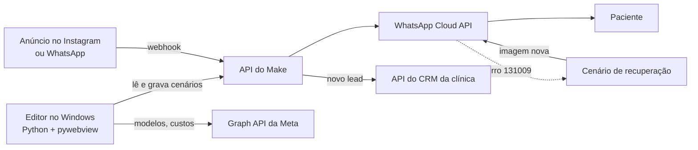

# Editor de conversas de WhatsApp: estudo de caso

Trabalho freelance para uma clínica odontológica e médica. O nome do cliente, os textos das mensagens, os números e os IDs ficam de fora; este repositório conta o problema, a solução e as decisões técnicas.

**O problema:** a clínica atende os pacientes pelo WhatsApp com uma conversa automática de boas-vindas, com menus e botões, montada em cenários do Make. Trocar uma frase ou uma imagem exigia abrir cenários enormes, e a equipe tinha medo de quebrar o atendimento. Além disso, os leads dos anúncios do Instagram não chegavam ao CRM da clínica, e a imagem dos modelos de mensagem vencia sem ninguém perceber.

**A solução:** três peças.
1. Um programa para Windows que mostra a conversa como o paciente recebe e deixa a equipe editar sem abrir o Make.
2. Um cenário que se recupera sozinho quando a imagem do modelo vence (erro 131009 da Meta).
3. Os leads de anúncio do Instagram e do WhatsApp entrando direto no CRM.

## Arquitetura

## Casos

1. [O editor: a equipe muda, o paciente vê](casos/01-editor.md)
2. [Quando a imagem do modelo vence: recuperação automática do erro 131009](casos/02-recuperacao-131009.md)
3. [Leads de anúncio direto no CRM, inclusive sem telefone](casos/03-leads-de-anuncio.md)

## Stack

Python, pywebview (WebView2), Nuitka, HTML/CSS/JavaScript, API do Make, Graph API e WhatsApp Cloud API da Meta, webhooks, Google Drive e a API REST do CRM.

## Autor

Gean Bonni, desenvolvedor Python. [LinkedIn](https://www.linkedin.com/in/geanbonni) · [GitHub](https://github.com/geanprofcd)
