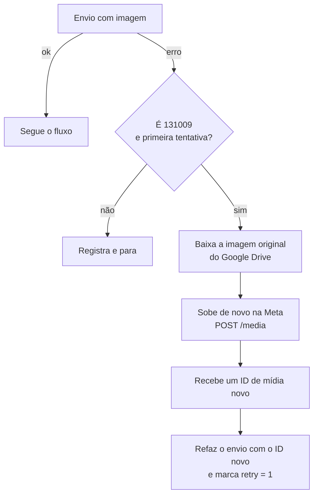

# Quando a imagem do modelo vence: recuperação automática do erro 131009

## O problema
Modelos de mensagem do WhatsApp com imagem no cabeçalho usam um ID de mídia enviado à Meta. Esse ID tem validade de cerca de 30 dias. Quando vence, o envio falha com o erro **131009**.

No cenário de boas-vindas, o módulo do envio não tinha tratamento de erro. A falha fez o Make desligar o cenário inteiro, e a fila de mensagens dos pacientes começou a acumular. Em outro cenário, um tratamento "ignorar erro" deixava a execução verde, mas o lead não seguia para o CRM.

## O que fiz

- Cada módulo de envio com imagem ganhou um tratador de erro que chama o cenário de recuperação com o tipo de mensagem, o destinatário e o erro.
- A recuperação só age no 131009 e só uma vez (campo `retry`), para não entrar em laço.
- O cenário principal passou a guardar execuções incompletas em vez de se desligar no primeiro erro.

## Como provei
Forcei o erro usando um ID de mídia vencido num número de teste. O envio falhou, a recuperação baixou a imagem, subiu de novo e refez a mensagem, que chegou.

## O que eu levo
Toda integração com terceiros falha um dia. A pergunta útil não é "como evitar o erro?", mas "o que o sistema faz sozinho quando ele acontecer?".
